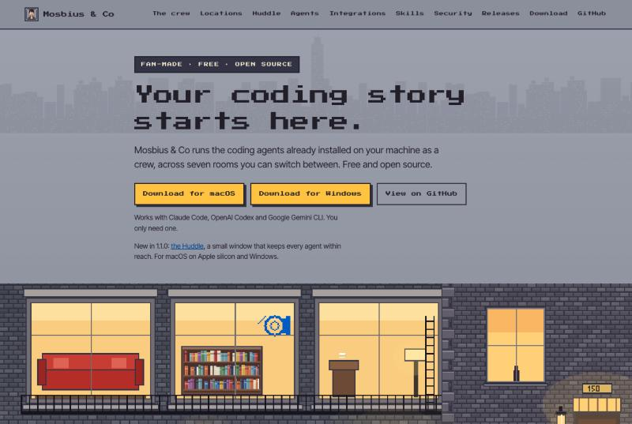
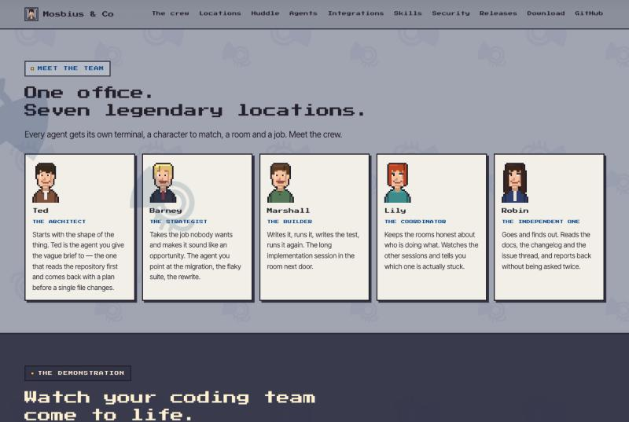
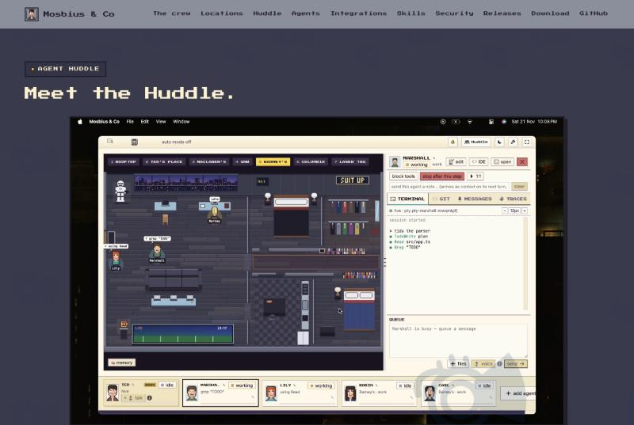
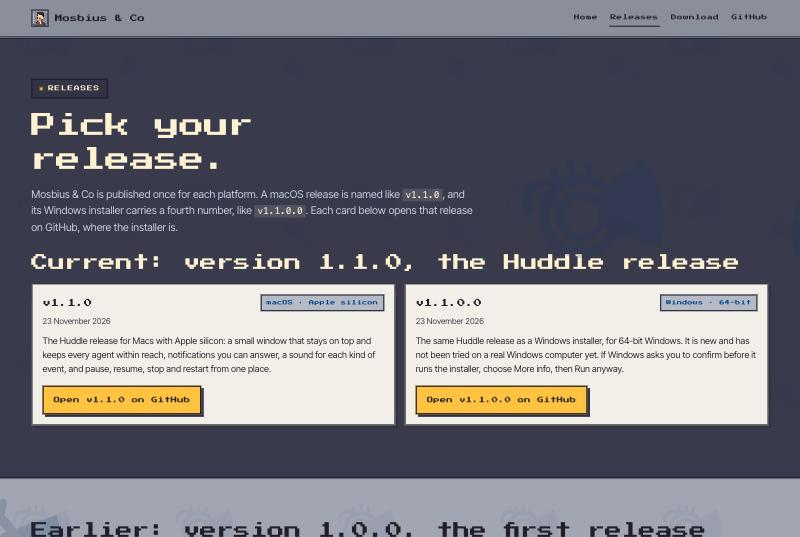
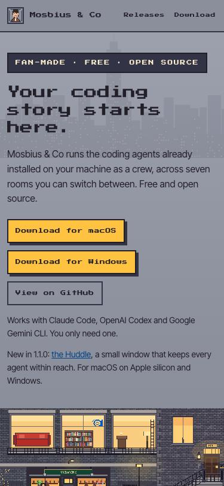
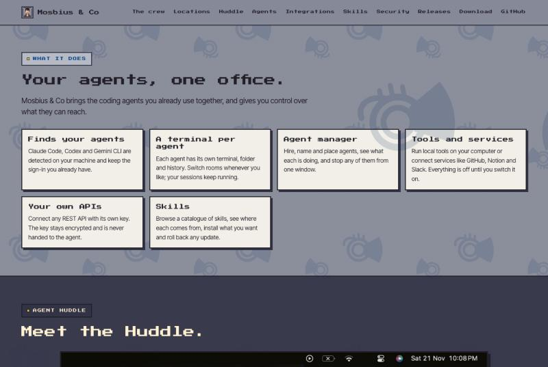
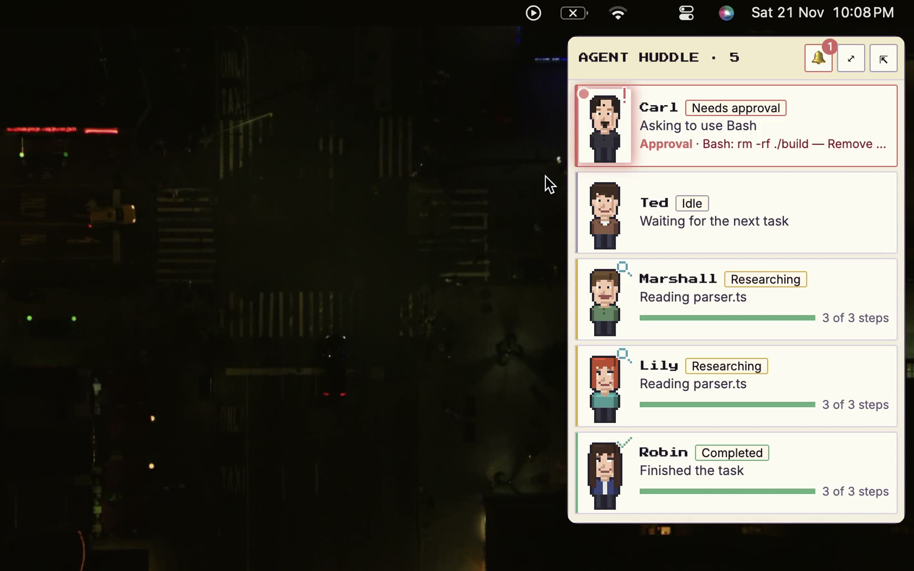
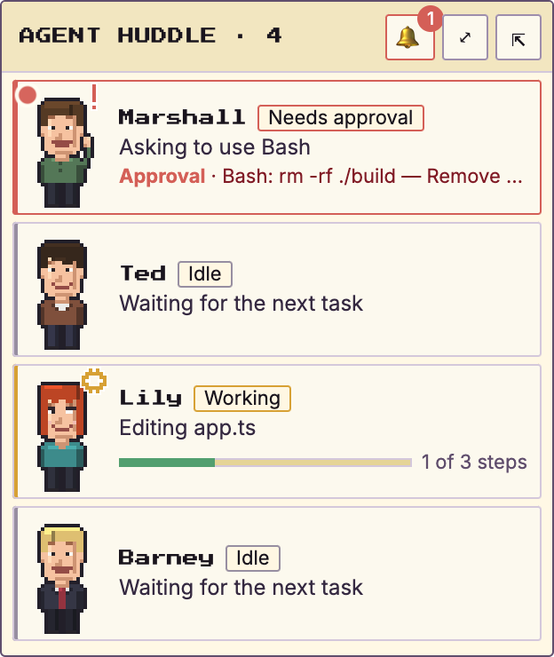
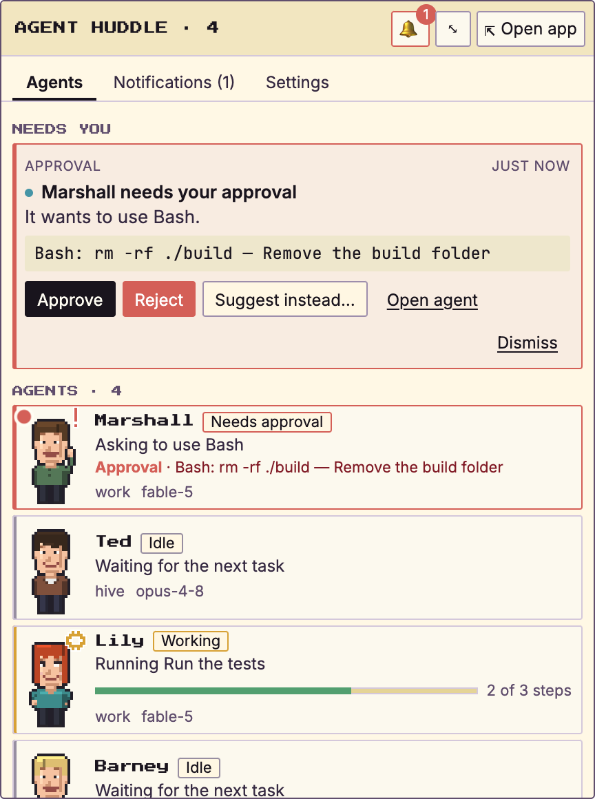
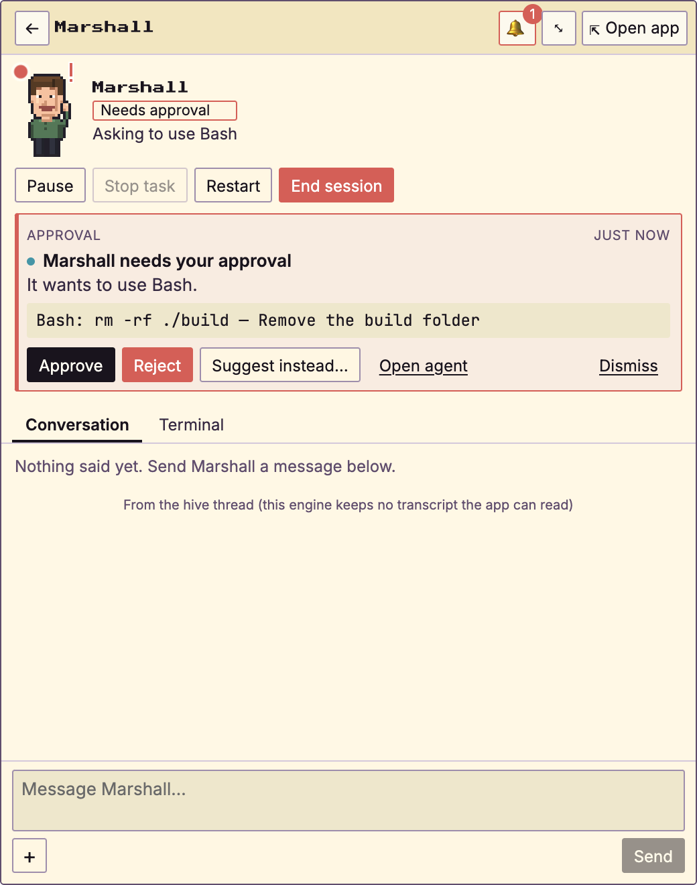

# Mosbius-Co-Site

Landing page for Mosbius &amp; Co., a desktop app that puts your coding agents in one place.

*A fan-made project, not affiliated with, endorsed by or connected to the show, its makers or its owners.*

The app, its code and its downloads are in [Mosbius-Co](https://github.com/rajguruyash/Mosbius-Co) ([releases](https://github.com/rajguruyash/Mosbius-Co/releases)).

## The site

A home page and a releases page. The home page meets you with the crew outside MacLaren's, then shows who is on the team, what the app does, the Huddle, the integrations and skills, and where to get it.

<table>
  <tr>
    <td width="50%" valign="top"> <b>Meet the crew</b></td>
    <td width="50%" valign="top"> <b>The Huddle</b></td>
  </tr>
  <tr>
    <td width="50%" valign="top"> <b>Releases</b></td>
    <td width="50%" valign="top" align="center"> <b>On a phone</b></td>
  </tr>
</table>

## Features

- **A crew, not a pile of windows.** Many agents at once, each in its own terminal with its own folder, history and memory. Mix Claude Code, Codex and Gemini CLI in the same office.
- **Work alone or together.** Use one agent and ignore the rest, or let a boss hand out tasks and agents pass work to each other.
- **A command centre.** For the selected agent: terminal, monitor, tasks, an "ask me" queue, triggers, memory, a graph, activity, skills and hired workers.
- **Agent Huddle and notifications.** Step away from the main window and keep a small, always-on-top Huddle beside your work: every agent as a character, what it is doing and who needs you. Desktop notifications tell you when a task finishes or an agent needs a decision, and you can approve, reject or answer from there, or open an agent's conversation and terminal. A finished task rings a bright piano hook, every other kind of event has its own short, warm, original tune, and Settings lets you hear every one and set the volume.
- **A world worth looking at.** Painted pixel-art rooms where characters sit down to work, wander off and take a break at the booth in MacLaren's.
- **Plug in your tools.** Connect services such as GitHub, Notion, Linear, Slack and Google Workspace, and decide exactly which agent may use what.
- **Skills.** Browse a catalogue of agent skills and install the ones you want.
- **Local first.** Your workspace stays on your machine, and there is no Mosbius & Co. account to create.

## The Huddle

- **Your Agents, Always Within Reach.** Huddle Mode.
- **Step In Only When It Matters.** Intelligent Notifications.
- **Unified Agent Control.** Switch between agents, inspect conversations, access terminals, send instructions, and manage tasks from a single compact interface. Your entire AI team stays coordinated and accessible from anywhere on your desktop.

> New in v1.1.0.

 <a href="assets/huddle/huddle-desktop.mp4">▶ Watch the video</a> (no sound)

<table>
  <tr>
    <td width="33%" valign="top"> <b>Compact</b></td>
    <td width="33%" valign="top"> <b>Expanded</b></td>
    <td width="33%" valign="top"> <b>One agent</b></td>
  </tr>
</table>

Built upon the original <a href="https://github.com/HarnessMD/munder-difflin">Munder Difflin</a> project; credit to its creator, Chaitanya Giri, for the foundational work.
